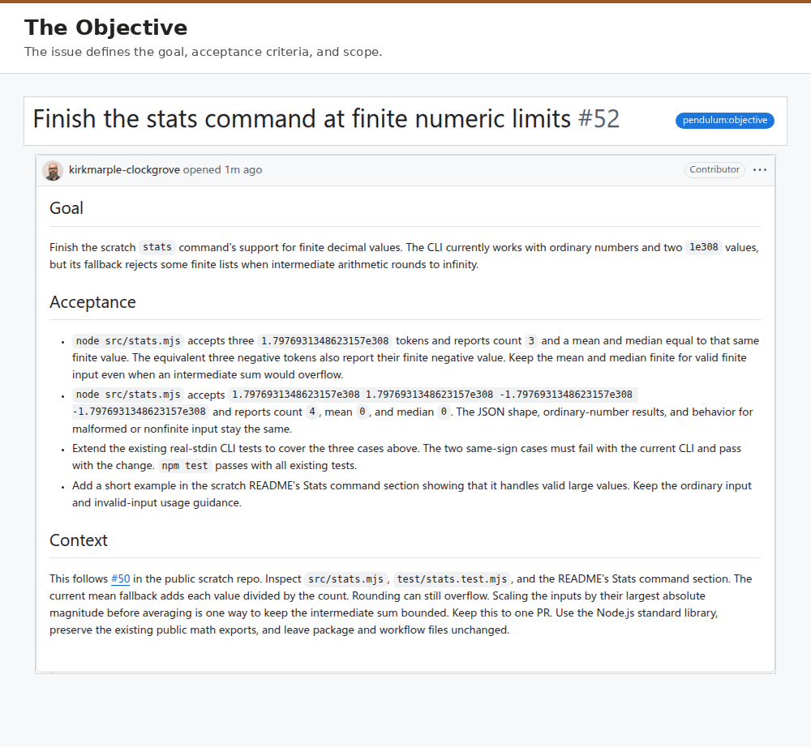

<p align="center">
  
</p>

<h1 align="center">Clockgrove Pendulum</h1>

<p align="center"><strong>Label a GitHub issue, walk away, come back to a reviewed pull request.</strong></p>

<p align="center">
  <a href="https://github.com/clockgrove/pendulum/releases"></a>
  <a href="https://github.com/clockgrove/pendulum/actions/workflows/quality.yml"></a>
  <a href="LICENSE"></a>
</p>

Clockgrove Pendulum turns a GitHub issue into a pull request (PR), using the coding agent you choose: Claude Code, Codex or GitHub Copilot CLI. You write what you want and what "done" means, and label the issue `pendulum:objective`. The coding agent plans and builds the change, Pendulum opens the PR, and a separate agent run reviews it. Then you merge it yourself, or, with auto-merge on, Pendulum merges it once your required CI checks pass.

It is for maintainers of a GitHub repository with CI on pull requests who want to hand whole features to a coding agent, from a change that fits in one PR to an epic delivered as a series of PRs, and keep their own issues, checks and merge queue as the workflow. It runs on GitHub Actions or on your own machine and keeps all its state in GitHub, so there is no server or database to host.

- **The reviewer comments; it does not approve.** Your required checks decide whether a change can merge. With auto-merge on, no person reads the code before it lands, so setup recommends starting with auto-merge off.
- **Pendulum is free (MIT); the runs are not.** Your model provider bills the coding agent's usage, and a private repository uses your GitHub Actions minutes.
- **Status:** 0.10.x, the release candidate for 1.0. Use it on real work, but names and inputs may still change before 1.0 ([Versioning](#versioning)).

[A real run](#a-real-run) · [Will it work for you?](#will-it-work-for-you) · [Quick start](#quick-start) · [How it works](#how-it-works) · [When it needs you](#when-it-needs-you) · [Costs and control](#what-it-costs-and-how-to-stay-in-control) · [Documentation](#documentation)

## A real run

[Issue #3](https://github.com/clockgrove/pendulum-scratch/issues/3) on the public scratch repository asked for a `multiply(a, b)` function with a test and a README entry. Pendulum ran it on GitHub Actions with Claude Code and auto-merge on, and [pull request #4](https://github.com/clockgrove/pendulum-scratch/pull/4) merged through the merge queue with no one touching it after the label.

| Step | In this run |
| --- | --- |
| **Filed and labelled `pendulum:objective`** | 02:23:41 UTC, 2026-11-17 |
| **PR opened** | 02:25:40 |
| **Reviewer's comment** | 02:26:39 |
| **Merged through the merge queue** | 02:27:36, 3 min 55 s after filing |
| **Reported model cost** | $0.52: $0.36 for the worker (`claude-opus-5-5`, with `claude-sonnet-5-5` sub-agents), $0.16 for the reviewer (`claude-fable-5-2`), on an Anthropic API key, as Claude Code reported it in the runs' usage records. GitHub Actions minutes are not included. |

This is one small, successful run, chosen so each step is easy to follow on GitHub; Pendulum is meant for larger work ([Write a good Objective](#write-a-good-objective)). It is not a typical cost or a measure of reliability. [bench/README.md](bench/README.md) describes how Pendulum scores runs: whether they merged with no one stepping in, solution quality, operator minutes and dollars.



<sub>Issue #3 above and pull request #4 below, as GitHub shows them.</sub>

## Will it work for you?

Pendulum needs:

- **CI that runs on pull requests, with at least one required check on your default branch.** Pendulum merges on those checks; a repository with no CI needs that first.
- **A public repository, or a private one on GitHub Pro, Team or Enterprise Cloud.** GitHub Free offers branch rules, and so required checks, on public repositories only. Pendulum uses a merge queue where GitHub offers one (repositories an organization owns: public ones, and private ones on Enterprise Cloud) and strict required checks elsewhere.
- **Admin rights on the repository**, and, where you run setup, your coding agent's CLI, the [`gh` CLI](https://cli.github.com) logged in, and Node 22 or newer.
- **A model credential GitHub Actions can use** ([Coding agent accounts](#coding-agent-accounts)):
  - Claude Code: an Anthropic API key, billed per use. For your own individual work, within your Claude plan's terms, your subscription works instead ([Claude on your subscription](docs/INSTALL.md#claude-on-your-subscription)).
  - Codex: an OpenAI API key or a Vercel AI Gateway key, billed per use. Your ChatGPT plan works only in [local mode](#where-it-runs).
  - Copilot CLI: a token from an account with a Copilot seat; runs are billed to that seat as AI credits.

It fits well for feature-sized work: what you would write up as a feature or an epic, with acceptance criteria someone can observe. Pendulum plans it, splits it across sub-agents and lands it as one or more PRs. It also needs tests that check the behaviour you care about, and lets you choose the coding agent per repository or per issue.

It is a poor fit, or needs care, when:

- **The change is a quick fix.** A one-line fix or a small tweak is faster and cheaper as a direct PR or a single agent session.
- **Your tests are thin.** Your CI is the only check of correctness: Pendulum merges whatever your required checks let through.
- **You need a person to approve every change.** Keep auto-merge off; the reviewer is not an approval gate.
- **Your issues come from the community.** Pendulum acts only on issues written by someone who can push to the repository (or a maintainer you name), so others' issues must be refiled.
- **The work spans repositories or is mostly CI changes.** Each Objective works in one repository, and Pendulum never pushes a change under `.github/workflows/`: it hands that part to you.
- **You need a hard limit on your bill.** Pendulum's spending limits cover only spend it can count ([Costs and control](#what-it-costs-and-how-to-stay-in-control)).

## Quick start

This takes you from nothing to a first PR, with the first-run settings setup recommends. You need what [Will it work for you?](#will-it-work-for-you) lists.

### 1. Install the plugin in your coding agent

Claude Code:

```sh
claude plugin marketplace add https://github.com/clockgrove/pendulum.git
claude plugin install pendulum@clockgrove
```

Codex:

```sh
codex plugin marketplace add clockgrove/pendulum
codex plugin add pendulum@clockgrove
```

GitHub Copilot CLI:

```sh
copilot plugin marketplace add clockgrove/pendulum
copilot plugin install pendulum@clockgrove
```

The plugin follows Pendulum's `main` branch. The workflow it writes into your repository pins an exact release tag, so what runs there changes only when you upgrade ([Versioning](#versioning)).

### 2. Ask it to set up your repository

Open a session of your coding agent in a local clone of **the repository you want Pendulum to work on** (not a clone of Pendulum), and say:

> Set up Pendulum for this repository.

If your agent takes "Pendulum" for something else of that name, such as the Python date-time library, run the skill's slash command instead (here `/pendulum:pendulum-setup`).

Setup asks three questions: which coding agent and credential ([Coding agent accounts](#coding-agent-accounts)), the spending limits, and whether Pendulum merges its own PRs. Choose its recommended **first-run preset**:

| Setting | Default | First-run preset |
| --- | --- | --- |
| `max_usd`, the spending limit per job | $25 | $5 |
| `max_concurrent`, Objectives running at once | 3 | 1 |
| `auto_merge` | on | off: Pendulum's PRs wait for you to merge them |

Setup then shows each change and waits for your yes. It creates a GitHub App for this one repository (a few clicks in your browser) and saves the App's two repository secrets, then has you save your model credential as a secret. It creates Pendulum's labels and a ruleset that requires your CI's checks, and offers to make your default workflow token read-only. Finally it opens a PR that adds `.github/workflows/pendulum.yml` ([everything setup adds](#what-it-adds-to-your-repository)).

### 3. Merge the setup PR, then check

Pendulum starts once the workflow file is on your default branch. Merge the setup PR, then ask:

> Is Pendulum set up correctly here?

This runs Pendulum's doctor, which changes nothing. Each line reads PASS, WARN or FAIL with the fix, and the last line says `ready` when nothing fails. Fix what a FAIL names and ask again. Setup also runs doctor before you merge; a warning then that the workflow file is not on your default branch yet is expected.

### 4. File your first Objective

Start with a modest feature: one your CI can test, in this repository, that touches no workflow files. With the first-run preset's $5 per job, a feature spanning a few files suits a first run; raise `max_usd` before you hand Pendulum larger work, and set `max_objective_usd` if you want a limit on one Objective's total. Then ask, describing it in your own words:

> File a Pendulum Objective: `mytool list` should support `--format json` beside the table, so scripts can read its output.

The session writes the issue in the shape Pendulum reads and shows it to you. Its title is the outcome in a few words, and its body looks like this:

```markdown
## Goal

`mytool list` can print its records as JSON, so scripts can use them without parsing the table.

## Acceptance

- `mytool list --format json` prints a JSON array with one object per record, holding the fields the table shows, and exits 0.
- `mytool list` and `mytool list --format table` print the table as before.
- An unknown format exits 2 with an error that names the accepted values.
- Tests cover each case, and the README documents the option.

## Context

- No new dependencies.
```

It asks whether to start it now (it adds the `pendulum:objective` label), save it as a draft issue (`pendulum:draft`, which Pendulum never runs), or keep discussing. Start it.

### 5. Watch it, then merge

- One comment on the issue shows the run's progress, edited in place, and the issue's labels show its state (`pendulum:running`, `pendulum:in-review`).
- The coding agent plans, writes the code and runs your validation; Pendulum opens the PR and your required checks run on it.
- The reviewer comments on the PR, and the coding agent answers each comment.
- With the first-run preset, the PR is marked ready for review. Read it and merge it yourself.

Runs take from a few minutes to a few hours. When it merges, a finish card on the issue sums up the time, cost and who did what; the plan comment, the progress comment, the PR's body and the review show the detail ([What it records](#what-it-records)). If the issue comes back Blocked or with a Question instead, see [When it needs you](#when-it-needs-you).

**Why the issue has this shape:** the worker reads the issue as the whole specification. The Goal says what should change; each Acceptance entry is something a reviewer can check, and the reviewer judges every one, met or not; the Context records what you have already decided. Your tests then confirm the behaviour on the PR.

**Next steps:**

- **Run one Objective on another model:** add a `pendulum:model:<id>` label to its issue before starting it; the repository's default stays for the rest ([Choose the harness and models](docs/USAGE.md#choose-the-harness-and-models)).
- **Let Pendulum merge:** once you trust its PRs, set `PENDULUM_AUTO_MERGE: true` in the `env` block of `.github/workflows/pendulum.yml` and merge that change. `max_usd` and `max_concurrent` can also be raised with repository variables, such as `gh variable set PENDULUM_MAX_USD --body 25` ([Inputs that tune cost](docs/INSTALL.md#inputs-that-tune-cost)).
- **Set it up without the plugin:** the same setup runs as scripts from a clone of Pendulum ([Set it up](docs/INSTALL.md#set-it-up)).

## How it works

1. **You label an issue `pendulum:objective`.** The issue is now an Objective, and its text is the whole specification.
2. **A worker plans and builds.** The worker is the coding agent, on a strong model. It writes a plan, which Pendulum posts on the issue, hands the plan's items to implementer sub-agents, usually on a cheaper model and side by side where they touch separate files, then integrates their work in its own checkout, and Pendulum opens a PR. A large Objective arrives as a series of PRs, one open at a time, each part starting once the one before has merged (up to six by default, `max_parts`).
3. **Your CI decides.** The worker waits for your required checks. When one fails, it keeps fixing while each pass makes progress, within the job's spending and time limits, then the Objective is Blocked.
4. **A reviewer comments.** The reviewer is a separate agent run that compares the change with the issue and judges each Acceptance entry. The worker must answer each comment: fix it, or explain why the issue or the repository's rules already settle it.
5. **The PR lands.** With auto-merge on, Pendulum merges the commit that was reviewed once your required checks are green on it, through your merge queue when your repository has one. With auto-merge off, the PR waits for you.

### Who can do what

| Part | What it does | What it cannot do |
| --- | --- | --- |
| **Worker** (your coding agent) | Edits files and runs commands in a sandbox, in its own checkout | Push, comment or open PRs; change protected files such as `.github/`, `CODEOWNERS` or `.claude/` |
| **Reviewer** (a separate agent run) | Comments on the PR and judges each Acceptance entry | Approve or reject the PR. It is not a person, and it may use the same model as the worker |
| **Pendulum's scripts** | Make every push, PR, comment and merge, as a GitHub App you create for this one repository | Push a change under `.github/workflows/` |
| **Your required checks** | Decide whether the reviewed commit can merge | Test anything your tests do not test |
| **You** | Start, stop and restart Objectives, answer Questions, and merge when auto-merge is off. A "request changes" review from someone with write access holds the merge | |

Pendulum acts only on issues written by people who can push to the repository, or by maintainers you name during setup, and counts only their comments as answers: a stranger's issue or comment cannot instruct the worker.

### What it records

Every Objective leaves a written trail on GitHub, so you can see how Pendulum ran it without opening a log.

**When an Objective merges, Pendulum posts a finish card on its issue:** one comment that sums up the run. It has a headline with the time to merge and the cost, status, wall-clock and cost badges, a sentence on what you did and what Pendulum did (commits, lines and files changed, checks passed, review findings), a timeline of the stages, a cost table by stage and model with a chart, where the dollars went (including any rework Pendulum caused, shown apart), and the full run log folded away. Every figure comes from GitHub or Pendulum's own records; anything it has no record of shows as unknown, never as an estimate. On GitHub Actions and the cloud sandbox, the merged PR's body gets the same headline and badges at its top. An Objective that ends Blocked or with a Question gets no card ([The finish card](docs/USAGE.md#the-finish-card)).

Along the way, and for every Objective however it ends:

| Where | What it shows |
| --- | --- |
| **Plan comment** on the issue | The worker's plan: the goal in its own words, a checklist mapping each Acceptance entry to the files it changes, ticked as items are done, and every assumption it made |
| **Progress comment** on the issue, one per run | A live status line (elapsed time, turns, tool calls, the sub-agents running and what each was asked), then each phase with its clock (setup, the coding agent, each validation pass, the reviewer, the answer pass) and an exit line with the run's outcome and spend, such as `exit: delivered; usd 0.35637` |
| **The PR's body** | For each Acceptance entry, the change that meets it and the test that proves it; every validation command as run, with its result; anything proved only against a fake; the assumptions; and anything left undone, with why |
| **The reviewer's comment** on the PR | Its findings, tied to lines, and each Acceptance entry as the reviewer judged it, met or not; under each finding, the worker's reply: the commit that fixed it, or why no change is needed |
| **Blocked or Question notice** on the issue | The reason, the fix, and whether to resume or restart |
| **Labels and Project board** | Where each Objective stands: `pendulum:running`, `pendulum:in-review`, `pendulum:blocked`, `pendulum:question` |
| **Usage artifact** on each Actions run | `pendulum-usage-<issue>`: the models, tokens and dollars, how the job ended, and its event log, kept up to 90 days. On a public repository the session transcripts are sealed by default ([Data and privacy](docs/PRIVACY.md#what-goes-to-github)) |
| **Scorecard** | Ask "Show the Pendulum scorecard": one row per Objective with whether it merged with no one stepping in, solution quality, operator minutes and dollars ([bench/README.md](bench/README.md)) |
| **Cost report** | Ask "What did Pendulum cost this month?": totals by billing kind, runs of unknown cost, and where the tokens went ([docs/REPORT.md](docs/REPORT.md)) |

The [real run](#a-real-run) above shows the progress comment and the reviewer's comment as they appear on GitHub. [What you see on the issue](docs/USAGE.md#what-you-see-on-the-issue) has the details.

## Write a good Objective

An Objective is a feature or an epic: work you would otherwise plan, break into tasks and land over one or several PRs. Pendulum does that planning and splitting itself, so write the issue as you would brief an engineer taking on the whole feature:

- **Goal:** what users or callers can do once it is done, and why. State the outcome, not the implementation.
- **Acceptance:** each thing that must be true, checkable through the real path: a command and its output, a request and its response, a behaviour a test proves. The reviewer judges every entry, met or not.
- **Context:** what you have already decided, contracts that must not change, and what is out of scope. Out-of-scope notes go here, never under Acceptance.

The worker asks you something only when the work depends on a decision that should be yours (a Question). Otherwise, where the issue admits more than one reading, it takes the simplest one that meets every Acceptance entry and records it as an assumption, so write down what you have already decided.

| Weak | Better |
| --- | --- |
| "Add team invitations." | Goal: a workspace admin can invite people by email, and an invitee joins with one link. Acceptance: an invitation emails a link valid for 7 days; following it after sign-up adds the user to that workspace as a member; an expired or used link shows an error page; admins can list and revoke pending invitations; tests cover each path. Context: use the existing mailer; the sign-up form does not change. |
| "Rebuild reporting." | Split the epic where it has a natural order: one Objective for the report export API, and one for the page that uses it, marked as blocked by the first. |

**For an epic with an order,** file several Objectives and link them with GitHub's issue dependencies (blocked by), added before an issue gets its `pendulum:objective` label: Pendulum starts each one once the issues it waits on are closed. Objectives without an order run side by side, up to `max_concurrent`; where two edit the same files, Pendulum rebases or holds back the later one so their changes do not collide ([Siblings that touch the same files](docs/USAGE.md#siblings-that-touch-the-same-files)).

**Quick fixes are better as a direct PR.** Pendulum's planning, review and CI loop is worth its cost on feature-sized work.

Your tests check only what they test. A green check is evidence about those properties, not proof that the whole change is correct. [Write an Objective](docs/USAGE.md#write-an-objective) has the full guidance.

## When it needs you

A run that goes well needs nothing from you. When one needs you, Pendulum does all the work it can, then hands the Objective back as **Blocked** or with a **Question**. Your other Objectives keep running. Ask "Why is Pendulum Objective 12 Blocked?" and your session reads the notice and offers the next step.

| Situation | What you do |
| --- | --- |
| PR ready for review (auto-merge off) | Read it and merge it through your usual process. |
| **Blocked:** Pendulum could not finish, for example a check still fails or a spending limit was reached. One comment on the issue gives the reason, and the PR becomes a draft | Fix what the comment names, then label the issue `pendulum:objective` again. It resumes from its branch and PR. |
| **Question** in a draft PR: the work depends on a decision that should be yours, such as changing a public interface | Comment your decision on the issue or the PR, then mark the PR ready. |
| **Question** on the issue: the work needs another repository | Split it into one Objective per repository and label them, or comment how to do it in this repository alone: the next run picks up your answer, with no relabelling. |
| The work needs a workflow change | Pendulum leaves the change in a comment on the issue, labelled `pendulum:handover`. After the PR merges, ask "Apply the Pendulum workflow hand-over for Objective 12" ([Workflow changes](docs/USAGE.md#workflow-changes)). |
| Stop one Objective | Remove its `pendulum:objective` label, close its issue, or ask "Stop Pendulum Objective 12". A run in progress ends within about two minutes with its spend recorded; label it again to resume. |
| Start over from revised text | Label the issue `pendulum:restart`, or ask "Restart Pendulum Objective 12". The earlier PR is closed and its branch deleted. |
| Stop everything | `gh workflow disable pendulum.yml` and cancel any runs in the Actions tab. In local mode, stop `pendulum serve` with Ctrl-C. With the cloud sandbox, also stop the Objective's sandboxes in your Vercel project. |

[Blocked and Question](docs/USAGE.md#blocked-and-question) and [An Objective's lifecycle](docs/USAGE.md#an-objectives-lifecycle) cover each case in full.

## What it costs, and how to stay in control

Pendulum has no paid tier or hosted service, and no bill comes from Clockgrove. You pay the providers you choose, directly:

- **The coding agent's model:** your Anthropic, OpenAI or Copilot account, or your Vercel AI Gateway key.
- **CI runners:** GitHub Actions minutes on a private repository, including a short scheduled check every ten minutes; or your own machine in local mode.
- **A cloud sandbox,** only if you opt in: your Vercel account.

**Pendulum's limits apply to the spend it can count. They are not a ceiling on your provider bill:** set a budget or limit with your provider for that. The limits are:

| Setting | Default | What it limits |
| --- | --- | --- |
| `max_usd` | $25 | Each worker or reviewer job. Every job gets its own limit, so one Objective with several PRs, re-reviews or restarts can spend several times this. |
| `daily_usd` | $100 | Starting new work: once the UTC day's counted spend reaches it, no new worker job starts that day. Jobs already running, reviews and their answers go on, so a day can end above it. |
| `max_objective_usd` | none | One Objective across all its jobs and PRs: once its counted spend reaches it, its next job starts nothing and the Objective is Blocked, naming the limit and the total. The job that crosses it finishes, and a restart starts the count over. |
| `max_concurrent` | 3 | Objectives running at once. |
| `timeout_minutes` | 240 | Each job's wall-clock time. |

Some spend cannot be counted: a run that crashed before its coding agent reported a cost, for example, or a Codex model Pendulum has no price for. Pendulum shows it as unknown ("$3.10 plus 1 run of unknown cost"), never as $0 or an estimate, and does not count it against the limits. Each dollar figure also says how it is billed: per use on an API key, "API-equivalent at list prices" on a Claude or ChatGPT subscription, or Copilot AI credits billed to the seat. A run inside your own agent session (`/pendulum:pendulum-run --here`) is neither limited nor counted. [Inputs that tune cost](docs/INSTALL.md#inputs-that-tune-cost) gives every case, and [Spend](docs/LOCAL.md#spend) covers local mode.

## Coding agent accounts

Every run uses an account of your coding agent: an API key, a subscription token or a login. Setup asks which one and has you save it, and doctor checks that it is there.

| Coding agent | On GitHub Actions, a repository secret | In local mode |
| --- | --- | --- |
| Claude Code | `ANTHROPIC_API_KEY`, an Anthropic API key billed per use. Or, for your own individual work on your Claude plan, `CLAUDE_CODE_OAUTH_TOKEN` from `claude setup-token`, with setup's `--credential plan` ([Claude on your subscription](docs/INSTALL.md#claude-on-your-subscription)) | The Claude Code login you already use |
| Codex | `CODEX_API_KEY`, an OpenAI API key, or `PENDULUM_CODEX_GATEWAY_KEY`, a Vercel AI Gateway key. A ChatGPT sign-in is refused on Actions | The Codex login you already use, a ChatGPT sign-in included |
| Copilot CLI | `COPILOT_GITHUB_TOKEN`: a fine-grained token with only the Copilot Requests permission, from a user with a Copilot seat | The same kind of token, saved to `~/.config/pendulum/copilot-token` |

Save a secret with `gh secret set <NAME>` and paste the value at its prompt; `--body` would leave it in your shell history.

**Several accounts** of one coding agent, such as two subscriptions or a subscription and an API key, can share the work:

- **Each run uses one account.** By default that is the agent's first account. A `pendulum:account:<name>` label on an issue pins that Objective to another account.
- **Automatic choice, off by default,** starts each run that has no pin on a free account, preferring the one with the most quota left where the agent reports it. A usage limit then sets aside only the account that hit it, and work goes on on the others.
- **On GitHub Actions,** list the accounts in your workflow's `env` block, the first being the default, and save each extra account's credential under its own secret name:

  ```yaml
  PENDULUM_ACCOUNTS: '{"claude": ["claude", "claude-2"]}'
  PENDULUM_AUTO_ACCOUNT: "1"  # optional: automatic choice
  ```

  The account `claude-2` reads `ANTHROPIC_API_KEY_CLAUDE_2` (`CLAUDE_CODE_OAUTH_TOKEN_CLAUDE_2` on a plan), while `claude` keeps the usual secret. Then run setup again and merge the workflow it writes, which names each account's secret in its jobs ([Several accounts](docs/INSTALL.md#several-accounts)).
- **In local mode,** list each account's login folder or token file in `~/.config/pendulum/accounts.json` on that machine, and start `pendulum serve` with `PENDULUM_LOCAL_AUTO_ACCOUNT=1` for automatic choice ([Accounts](docs/LOCAL.md#accounts)).

The progress comment, the usage record and the scorecard name the account each run used.

## What it can touch

- **The worker and the reviewer cannot write to GitHub**, wherever they run. Pendulum's scripts make every push, PR, comment and merge: as the GitHub App on Actions, and with a token for this one repository in local mode.
- **The commands a worker runs are sandboxed** and see none of your credentials unless you share one. The exceptions are `/pendulum:pendulum-run --here` and `/pendulum:pendulum-review-here`, which run inside your own agent session, unsandboxed, as you ([Commands](docs/USAGE.md#commands)).
- **No telemetry, and nothing goes to Clockgrove.** Your code and issue text go to your model provider, and Pendulum's records stay in GitHub. On a public repository, the usage records attached to Actions runs are readable by anyone signed in to GitHub. [Data and privacy](docs/PRIVACY.md) lists exactly what goes where, including the few other hosts Pendulum contacts.

### What it adds to your repository

- **One workflow file**, `.github/workflows/pendulum.yml`.
- **A GitHub App** that you create and install on this one repository. Its ID and private key are two secrets. Its permissions: contents, pull requests, issues, projects: write; checks, commit statuses: read; actions: read, optional (cloud-sandbox logs and session restore); nothing else, never workflows. Projects is under Organization permissions in the App's settings, and a repository a user owns needs none; the rest are Repository permissions.
- **A model credential**, saved as a secret and handed only to the worker's and the reviewer's own process.
- **GitHub settings:** the `pendulum:` labels, a Project board (on a repository an organization owns; elsewhere the labels carry each Objective's state), a ruleset named `pendulum` that requires your CI's checks (and adds the merge queue where GitHub offers one), and squash merges that take each PR's title and body.

Nothing else is added unless you accept it: setup offers to commit Pendulum's skills to the repository, which the agents' cloud sessions need. [Install footprint](docs/INSTALL.md#install-footprint) has the details, with [Upgrade](docs/INSTALL.md#upgrade) and [Uninstall](docs/INSTALL.md#uninstall).

## Where it runs

- **GitHub Actions (the default):** each job runs on a fresh GitHub-hosted runner, unless you name a runner of your own.
- **Local mode:** your own machine, with `pendulum serve` or `pendulum run <issue>`.
- **Cloud sandbox (opt-in):** one pausable sandbox per Objective on Vercel Sandbox ([docs/ADAPTERS.md](docs/ADAPTERS.md)).

Wherever it runs, each Objective's state lives in GitHub: the branch, the PR, the issue's comments and labels, the board, and a usage record for each job.

### Local mode

Local mode runs the same worker and reviewer on your machine: Claude Code and Codex on the login you already have, with no API key, and Copilot on the same seat token as on Actions. It needs no GitHub App and no secrets stored in GitHub, but more machine setup: sandbox packages and a GitHub token for this one repository. It runs on Linux and WSL2; on macOS, Claude Code and Codex work in the sandbox but have not yet been proven on a full run ([Platforms](docs/LOCAL.md#platforms)).

With the plugin installed, say "Set up Pendulum in local mode" in your repository's clone; the session walks you through each step on your machine. Then say "Start the Pendulum local loop" (or run `pendulum serve`, which is on your PATH in Claude Code) and file Objectives as in the [Quick start](#4-file-your-first-objective). Where Pendulum's workflow is also active on GitHub, add the `pendulum:local` label to run an Objective on your machine. [Set it up](docs/LOCAL.md#set-it-up) and [Routing](docs/LOCAL.md#routing) have the details.

## How it differs

| | Pendulum | Copilot coding agent and Agent Merge | claude-code-action | OpenHands on GitHub |
| --- | --- | --- | --- | --- |
| **Coding agent** | Claude Code, Codex or Copilot CLI | Copilot, or the Claude and Codex agents GitHub runs | Claude Code | OpenHands' own agent, with any LLM |
| **Review** | A separate reviewer run on every PR; the worker answers each comment | Copilot code review of its own changes, before it opens the PR | A separate review workflow you add | A separate review workflow you add |
| **Where it runs** | GitHub Actions or your own machine; state in GitHub, no server | GitHub's cloud | Your GitHub Actions runner | OpenHands Cloud |
| **How the PR lands** | Pendulum merges on your required checks, or leaves it for you | GitHub auto-merge; Agent Merge fixes failing checks and conflicts | It pushes a branch and links a pre-filled PR form | It opens a PR |

Each cell about another tool comes from that tool's own documentation; [docs/COMPARISON.md](docs/COMPARISON.md) quotes and links each source, and adds how each one starts work.

## Documentation

| I want to… | Read |
| --- | --- |
| Look up a term (Objective, harness, stage, Blocked, Question) | [Glossary](docs/USAGE.md#glossary) |
| Write an Objective, follow a run, or deal with Blocked and Question | [docs/USAGE.md](docs/USAGE.md) |
| See every request and the slash command and skill behind it | [Commands](docs/USAGE.md#commands) |
| Set up without the plugin, tune cost, upgrade or uninstall | [docs/INSTALL.md](docs/INSTALL.md) |
| Run on my own machine | [docs/LOCAL.md](docs/LOCAL.md) |
| Use the cloud sandbox or another third-party adapter | [docs/ADAPTERS.md](docs/ADAPTERS.md) |
| Know what data goes where | [docs/PRIVACY.md](docs/PRIVACY.md) |
| Compare Pendulum with alternatives, with sources | [docs/COMPARISON.md](docs/COMPARISON.md) |
| Understand the design, its contracts and the 1.0 bar | [docs/PLAN.md](docs/PLAN.md) |
| See what Pendulum has cost, and where the tokens went | [docs/REPORT.md](docs/REPORT.md) |
| See how runs are scored | [bench/README.md](bench/README.md) |
| Read release notes | [Releases](https://github.com/clockgrove/pendulum/releases) |

Pendulum is a plugin of [Agent Skills](https://agentskills.io) that Claude Code, Codex and GitHub Copilot CLI load the same way; plain-words requests reach them, and each is also a slash command ([Commands](docs/USAGE.md#commands)).

## Versioning

Pendulum is at 0.10.x, the release candidate for 1.0: run it on real work, but there is no stability promise until 1.0.

- **Your workflow pins an exact tag** (`clockgrove/pendulum@vX.Y.Z`); setup does this for you. Pendulum publishes no floating tag (no `v0`, no `v1`), and release tags cannot be moved or deleted, so what your workflow runs does not change until you upgrade.
- **The plugin follows `main`**, and with it the setup, doctor and filing skills, so they can be newer than the Action your workflow pins. Doctor warns when the plugin is older than that pin. There is no supported way to install the plugin at a release tag; to run setup at exactly a release, use the scripts from a clone of Pendulum at that tag ([Set it up](docs/INSTALL.md#set-it-up)).
- **Names may still change before 1.0.** A 0.10.x release may rename an input, a label or a job as the exception, and its release notes call the change out. [docs/PLAN.md](docs/PLAN.md) (The 1.0 bar) lists what freezes at 1.0 and what Pendulum must prove to get there.
- **Releases come often:** small patch releases, each with notes on the [Releases](https://github.com/clockgrove/pendulum/releases) page.
- **Supported:** the latest 0.10.x release gets security fixes; older tags do not ([SECURITY.md](SECURITY.md)).

## Help and contributing

- **Bugs, questions and ideas:** [open an issue](https://github.com/clockgrove/pendulum/issues). [CONTRIBUTING.md](CONTRIBUTING.md) says what helps in a report.
- **Security problems:** report them privately ([SECURITY.md](SECURITY.md)), never in a public issue.
- **Pull requests:** Pendulum is not taking outside pull requests yet.

## License

[MIT](LICENSE) © Clockgrove
